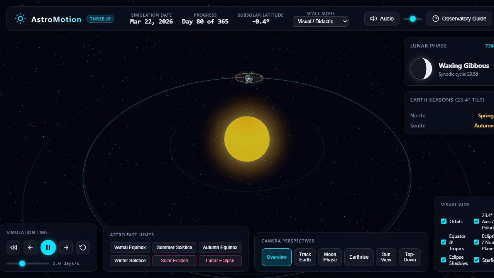

# 🌌 AstroMotion

> An interactive 3D celestial motion visualizer built with Three.js and vanilla JavaScript, demonstrating seasons, lunar phases, tidal locking, and eclipses.



## 🌟 Key Features

- **Astronomical Accuracy**: Simulates Earth's $23.44^\circ$ axial tilt toward Polaris, diurnal day/night cycle with atmospheric scattering, lunar tidal locking, $5.15^\circ$ lunar orbital inclination, and solar/lunar eclipse geometry.
- **Zero Asset Dependencies**: Procedurally generates all surface textures on HTML5 canvases (Earth day/night, clouds, Moon maria and craters, Sun corona, and 12,000-star skybox).
- **Observatory HUD**: Real-time calendar with season tracking, live 2D lunar phase gauge, eclipse alerts, and time flow controls with equinox/solstice/eclipse fast-jumps.
- **Multiple Perspectives**: 6 preset camera views (System Overview, Track Earth, Moon Phase from Earth, Earthrise from Moon, Sun's view, Top-Down Ecliptic).
- **Interactive Audio**: Real-time procedural ambient soundscape synthesized using Web Audio API.

## 🚀 Quick Start

### Windows (One-Click)
Double-click `run.bat` to start the server and open the application in your browser.

### Command Line
Run either:
```bash
python serve.py
```
or:
```bash
python -m http.server 8000
```
Then visit `http://localhost:8000` in any modern web browser.

## ⌨️ Controls & Shortcuts

| Input | Action |
| --- | --- |
| `Space` | Play / Pause |
| `←` / `→` | Step backward / forward 1 day |
| `1` – `6` | Camera views (Overview, Track Earth, Moon Phase, Earthrise, Sun, Top-Down) |
| `M` / `H` | Toggle cosmic audio / HUD overlay |
| `Mouse Drag` | Orbit & rotate view |
| `Mouse Wheel` | Zoom in / out |
| `Right Drag` | Pan camera |

## 📁 Project Structure

- `index.html` — Observatory interface and main entry point
- `serve.py` / `run.bat` — Local development server and one-click launcher
- `css/styles.css` — Glassmorphic observatory HUD styling
- `js/` — Simulation scripts (Keplerian orbits, celestial shaders, procedural textures, UI controls, audio)
